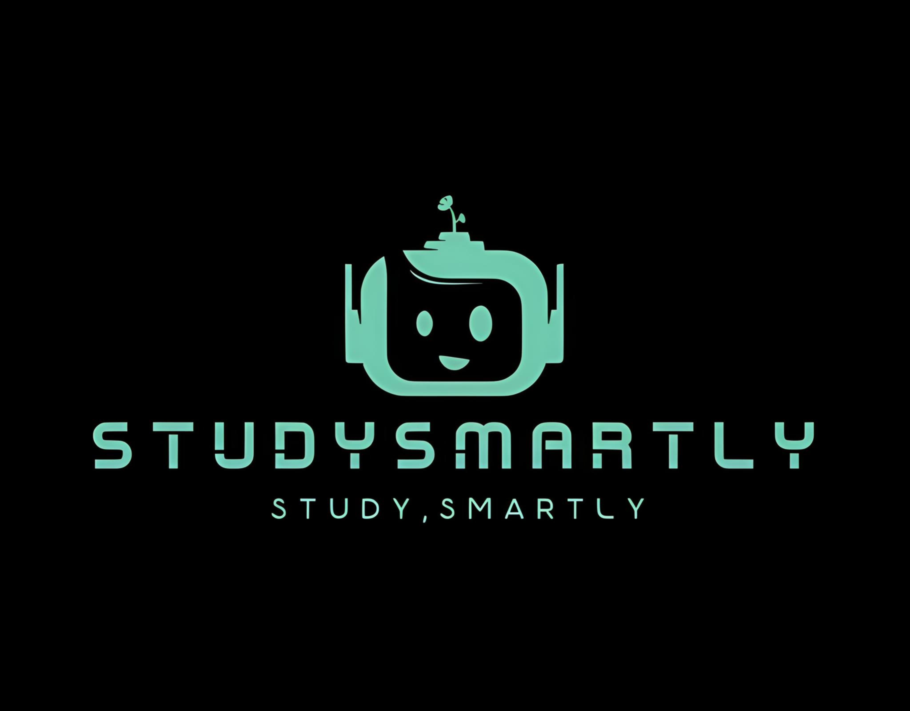

<div align="center">
  
  
  # StudySmartly
  
  **The AI-Powered Visual & Adaptive Learning Platform**
  
  [](https://react.dev)
  [](https://tanstack.com)
  [](https://supabase.com)
  [](https://vercel.com)
  [](https://tailwindcss.com)
  
  <p align="center">
    An independent, full-stack EdTech platform designed to make studying visual, interactive, and adaptive. Built entirely on free-tier infrastructure without sacrificing performance or security.
  </p>
</div>

---

## 🎯 The Vision
StudySmartly started as an experiment to escape proprietary no-code platforms. It evolved into a fully independent ecosystem designed to prove that enterprise-grade AI educational tools should be accessible to every student, regardless of budget.

## ✨ Core Features

*   **🎨 AI Whiteboard:** A visual, speaking AI tutor. Generates spatial JSON schemas rendered stroke-by-stroke on an Excalidraw canvas, synchronized with browser-native text-to-speech. Includes an interactive "Atom Popper" mini-game during AI generation.
*   **📅 Adaptive Study Planner:** A deterministic scheduling engine. Parses unstructured syllabus data (PDF/Text), extracts topics, and generates conflict-free revision time-blocks with spaced repetition.
*   **📝 PYQ Exam Arena:** Generates verified MCQs from past papers. Includes a **Mistake Analyzer** that diagnoses weak concepts and links directly to the Whiteboard for targeted explanations.
*   **🎴 Smart Flashcards (In Progress):** AI-generated flashcards using the SuperMemo-2 (SM-2) spaced repetition algorithm for optimal retention.
*   **🎤 Lecture Transcriber:** Browser-native real-time audio-to-text for capturing live lectures.
*   **📊 Presentation Studio:** Generates structured slide decks from prompts or uploaded notes.

## 🏗️ Technical Architecture

StudySmartly is engineered for high availability and zero-cost scalability:

*   **Fault-Tolerant AI Routing:** Implements a custom cascading failover chain (Google Gemini → Groq → OpenRouter) utilizing the Vercel AI SDK. Features strict Zod-based JSON schema enforcement to guarantee consistent inference uptime.
*   **Imperative Canvas Rendering:** Bypasses React’s virtual DOM for high-performance drawing. Utilizes Excalidraw’s imperative API to execute batched, 30ms state-update loops.
*   **Serverless Edge Architecture:** Deployed on Vercel's edge network with TanStack Start for type-safe, SSR-optimized routing.
*   **Security & Data:** Powered by Supabase PostgreSQL, utilizing strict Row-Level Security (RLS) policies, PKCE OAuth flows, and OTP authentication.
*   **Premium UI/UX:** Built with React 19, Tailwind CSS, and Framer Motion. Features an Awwwards-level glassmorphic design system with 60FPS spring physics and optimistic UI state hydration.

## 🛠️ Local Development

To run StudySmartly locally, you need Node.js and `pnpm` installed.

```bash
# 1. Clone the repository
git clone https://github.com/Adrizz101/StudySmartly.git
cd StudySmartly

# 2. Install dependencies
pnpm install

# 3. Set up Environment Variables
cp .env.example .env
# Fill in your Supabase, Gemini, Groq, and OpenRouter API keys in the .env file

# 4. Run the development server
pnpm run dev
